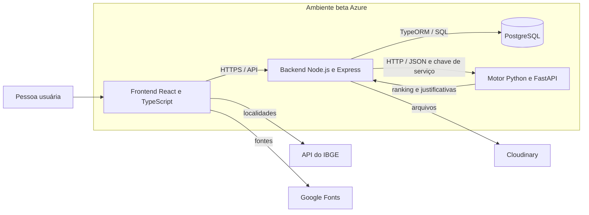

# Juntaí! Backend

**Juntaí!** é uma plataforma acadêmica de matchmaking para conectar startups, investidores anjo e mentores do ecossistema de inovação do Nordeste. O projeto integra o Projeto Integrador do 5º período de Análise e Desenvolvimento de Sistemas da Faculdade Senac Pernambuco.

Este repositório contém a API responsável por contas, perfis, autenticação, autorização, persistência, interações e integração com o serviço de recomendações. A interface e o motor Python são aplicações separadas.

**Demonstração beta na Azure:** [acessar a plataforma](https://delightful-beach-0c45f1a10.4.azurestaticapps.net/). Os perfis de demonstração são fictícios.

---

## 📌 Sobre o projeto

O Juntaí! busca facilitar a apresentação de startups, a descoberta de oportunidades e a aproximação com investidores e mentores. A API recebe as ações da interface, valida permissões, consulta e atualiza dados no PostgreSQL e solicita recomendações ao motor quando necessário.

O backend não decide se uma startup deve receber investimento. As sugestões apoiam a triagem; a análise e a decisão permanecem com os usuários.

### Repositórios

- [Frontend utilizado no beta](https://github.com/renatodelgado/Juntai-Frontend)
- [Backend utilizado no beta](https://github.com/renatodelgado/Juntai-Backend)
- [Motor de matchmaking utilizado no beta](https://github.com/renatodelgado/Juntai-matchmaking-IA)
- Repositórios de origem: [backend de Clara Melo](https://github.com/ClaraMelo72/Juntai-Backend) e [motor de Vinícius](https://github.com/vicent777/Juntai-matchmaking-IA). As versões podem diferir das cópias utilizadas no beta.

---

## 🎯 Objetivo

Disponibilizar uma API capaz de:

- Gerenciar contas, startups e perfis de investidores e mentores;
- Autenticar usuários e restringir operações por perfil e recurso;
- Consultar recomendações e manter o fluxo de descoberta e interesse;
- Organizar mensagens, reuniões e avaliações;
- Apoiar moderação, administração e registros de auditoria;
- Integrar banco, motor de recomendação e serviços de mídia.

---

## 👥 Atores

### Startup / empreendedor

Cadastra informações e materiais do negócio, apresenta necessidades e acompanha interessados, conversas e reuniões.

### Investidor anjo / mentor

Informa experiência e interesses, descobre startups e pode registrar interesse e iniciar conversas, conforme as permissões da conta.

### Administrador

Acompanha e modera perfis e denúncias e acessa recursos administrativos autorizados. O cadastro público não cria contas administrativas.

---

## 🚀 Funcionalidades

- Cadastro, autenticação, recuperação de senha e gestão de perfis;
- Descoberta de startups, filtros, recomendações e registro de interesse;
- Conversas, mensagens e agendamento e acompanhamento de reuniões;
- Avaliações e feedback após interações;
- Moderação de perfis e denúncias, ações administrativas e auditoria;
- Uploads de imagens e apresentações quando o serviço de mídia está configurado;
- Integração com o motor de regras e caminho supervisionado experimental.

Algumas operações exigem perfil ativo e aprovado. Pagamentos, operação comercial e exclusão integral da conta não estão concluídos. A presença de entidades relacionadas a consentimento não demonstra que os aceites do cadastro sejam gravados no servidor.

---

## 🏗️ Arquitetura



O frontend chama a API; o backend autentica, consulta dados necessários e envia uma projeção ao serviço FastAPI. A resposta é validada e entregue à interface. O motor não acessa o PostgreSQL diretamente. O diagrama também está em [`docs/arquitetura.md`](docs/arquitetura.md).

### Camadas da API

```text
Cliente → Rotas → Middlewares → Controllers → Services → Repositories → PostgreSQL
                                                  ↓
                                      Cliente HTTP → FastAPI
```

- **Rotas:** recebem as chamadas e associam middlewares e controladores.
- **Middlewares:** tratam autenticação e autorização compartilhadas.
- **Controllers:** interpretam requisições e encaminham operações.
- **Services:** concentram regras e coordenação entre componentes.
- **Repositories e entidades:** acessam e representam dados com TypeORM.
- **Migrations:** descrevem alterações no esquema; não são aplicadas automaticamente na inicialização.

Dados de contas, mensagens e reuniões são transacionais. Exposições e interações de descoberta são comportamentais. Recomendações são solicitadas sob demanda; a conclusão de reuniões é verificada periodicamente.

---

## 📂 Estrutura do projeto

```text
Juntai-Backend/
├── src/
│   ├── modules/             # Domínios: auth, startups, investidores,
│   │                        # matchmaking, mensagens, reuniões, moderação etc.
│   ├── shared/              # Banco, middlewares, erros, enums e configuração
│   │   └── database/migrations/
│   ├── App.ts               # Aplicação Express e rotas
│   └── Server.ts            # Conexão e inicialização
├── tests/                   # Testes automatizados e fixtures
├── docs/                    # Detalhes de integração e migrations
├── scripts/                 # Rotinas auxiliares
├── .env.example             # Exemplo de configuração sem segredos reais
├── docker-compose.yml       # PostgreSQL e API para desenvolvimento
├── Dockerfile
├── package.json
└── package-lock.json
```

---

## 🛠️ Stack

| Tecnologia | Responsabilidade |
| --- | --- |
| Node.js e TypeScript | Runtime e implementação da API |
| Express | Rotas e processamento HTTP |
| TypeORM e PostgreSQL | Entidades, persistência e migrations |
| JWT e bcrypt | Autenticação e hash de senhas |
| Cloudinary | Armazenamento de mídia quando configurado |
| Python e FastAPI | Serviço externo de matchmaking |
| Docker | Empacotamento e execução local do banco e serviços |

As versões estão em `package.json` e `package-lock.json`; o workflow do backend utiliza Node.js 24.

---

## 🔐 Autenticação e autorização

O login devolve um token JWT. As rotas protegidas recebem:

```text
Authorization: Bearer <token>
```

Os middlewares `ensureAuthenticated` e `ensureRole`, em `src/shared/middlewares`, verificam a sessão e o perfil. Serviços também verificam titularidade e condições específicas. Um `401` indica, por exemplo, sessão ausente ou inválida; um `403` pode indicar falta de permissão. O cadastro público cria perfis de startup e investidor/mentor, não de administrador.

### Endpoints principais

| Método | Rota | Finalidade |
| --- | --- | --- |
| `GET` | `/health` | Verifica a resposta do processo |
| `POST` | `/startups` | Cadastra startup e conta |
| `POST` | `/investidores` | Cadastra investidor/mentor e conta |
| `POST` | `/auth/login` | Autentica com e-mail e senha |
| `GET` | `/auth/me` | Retorna informações da conta autenticada |
| `POST` | `/auth/forgot-password` | Solicita recuperação de senha |
| `POST` | `/auth/reset-password` | Define nova senha com token válido |
| `POST` | `/startups/:id/interesse` | Registra interesse de investidor autorizado |
| `GET` | `/startups/interessados` | Lista interessados para a startup autorizada |

Os módulos de startups, investidores, mensagens, reuniões, avaliações, uploads, denúncias e administração possuem outras rotas com permissões próprias em `src/modules`.

---

## ⚙️ Instalação

### Pré-requisitos

- Git e Node.js 24 com npm;
- PostgreSQL 16 ou Docker com Compose;
- Python e serviço de matchmaking para recomendações;
- Cloudinary e Azure Communication Services somente para os respectivos fluxos de mídia e recuperação por e-mail.

### Clonar e instalar

```bash
git clone https://github.com/renatodelgado/Juntai-Backend.git
cd Juntai-Backend
npm ci
```

### Variáveis de ambiente

Copie `.env.example` para `.env`: `cp .env.example .env` no macOS/Linux ou `Copy-Item .env.example .env` no PowerShell. Gere um segredo JWT próprio com `node -e "console.log(require('crypto').randomBytes(48).toString('hex'))"` e coloque o resultado no arquivo local. Não versione `.env` nem compartilhe segredos.

| Variável | Finalidade |
| --- | --- |
| `NODE_ENV`, `PORT` | Ambiente e porta da API; o exemplo usa 3333 |
| `DB_HOST`, `DB_PORT`, `DB_USER`, `DB_PASSWORD`, `DB_NAME` | Conexão com PostgreSQL; o Compose expõe a porta 5433 no computador |
| `JWT_SECRET`, `JWT_EXPIRES_IN` | Assinatura e validade da sessão |
| `MATCHMAKING_API_URL`, `MATCHMAKING_TIMEOUT_MS` | Endereço e tempo limite do motor |
| `MATCHMAKING_API_KEY` | Chave compartilhada com o motor quando a autenticação estiver configurada |
| `MATCHMAKING_STRATEGY` | `rules` por padrão; `supervised` é experimental |
| `ACS_EMAIL_ENDPOINT`, `ACS_EMAIL_ACCESS_KEY`, `ACS_EMAIL_SENDER` | Serviço de envio de e-mail para recuperação |
| `PASSWORD_RESET_FRONTEND_URL`, `RECOVERY_TRUST_AZURE_INGRESS` | Endereço de redefinição e configuração do proxy confiável |

Os valores do banco no exemplo e no Compose destinam-se ao desenvolvimento local. Em ambientes compartilhados, use credenciais próprias e gerenciamento de segredos. `DB_SSL=true` ativa TLS na conexão com o banco; `CORS_ORIGINS` pode limitar origens permitidas.

### Banco de dados

Para iniciar somente o PostgreSQL do Compose:

```bash
docker compose up -d postgres
```

O banco ficará acessível na porta 5433 do computador. Para interromper os serviços do Compose, use `docker compose down`; os dados do volume permanecem preservados.

**Atenção ao banco vazio:** as migrations disponíveis são incrementais e pressupõem tabelas anteriores. Não há uma migration inicial completa no repositório, `synchronize` está desativado e o servidor não aplica migrations automaticamente. Um PostgreSQL recém-criado não é suficiente para os fluxos persistidos. Prepare um esquema de teste compatível e revise as migrations necessárias em ambiente isolado; não aplique migrations indiscriminadamente em bancos existentes nem restaure dados pessoais para testes.

### Iniciar a API

Com o banco de teste compatível e `.env` configurados:

```bash
npm run dev
```

A API usa `http://localhost:3333` por padrão. `GET /health` verifica a resposta do processo, mas não prova que o esquema e todos os fluxos estejam prontos. Para recomendações, inicie o motor e configure `MATCHMAKING_API_URL`, normalmente `http://127.0.0.1:8000`. Se a autenticação entre serviços estiver habilitada, configure a mesma chave no backend e no motor, nunca no frontend.

---

## 🧪 Testes e validação

Com as dependências instaladas e `JWT_SECRET` definido:

```bash
npm test
npm run build
```

Os testes usam fixtures e simulações em várias situações. Alguns testes de PostgreSQL, mídia e integração exigem variáveis e serviços adicionais e podem ser ignorados na suíte padrão. Consulte os próprios testes antes de habilitá-los e use somente ambientes isolados.

### Regras ECA

**Interesse:** evento: investidor confirma interesse; condição: os perfis estão ativos e aprovados; ação: o backend registra o evento se ainda não existir. Implementação: `src/modules/startups/services/StartupInterestService.ts`. O teste de idempotência está em `tests/matchmaking.test.cjs`:

```bash
node --test tests/matchmaking.test.cjs
```

**Reunião:** evento: verificação periódica; condição: uma reunião continua agendada após 24 horas de seu horário; ação: o backend altera seu estado para realizada. Implementação: `src/modules/reunioes/services/conclusaoAutomatica.ts` e `src/modules/reunioes/repositories/ReuniaoRepository.ts`. O teste correspondente está em `tests/feedback.test.cjs`.

---

## 🔒 Segurança e LGPD

As medidas implementadas incluem hash de senha com bcrypt, autenticação JWT, controles de acesso e variáveis de ambiente para segredos. O beta usa TLS na conexão com o banco e autenticação entre API e motor.

O cadastro pode reunir dados pessoais, informações profissionais e conteúdo inserido em perfis e mensagens. O canal para titulares, o registro verificável dos aceites, a exclusão integral, retenção e restauração ainda exigem definição ou implementação. A política da interface é provisória; não se deve declarar conformidade integral apenas pela existência de telas ou entidades.

---

## ☁️ Deploy, status e versão

O beta usa Azure Container Apps para a API e o motor, PostgreSQL na Azure e Azure Static Web Apps para a interface. O workflow `.github/workflows/azure-beta.yml` instala dependências, executa testes e build e publica uma imagem identificada pelo commit. Serviços externos e escala zero podem afetar disponibilidade e tempo da primeira resposta.

A tag `v1.0-high-tech` identifica a versão preparada para a entrega; commits posteriores não alteram essa tag. O projeto permanece em desenvolvimento e não há licença de distribuição explícita neste repositório.

---

## 🎓 Projeto Integrador e equipe

- **Curso:** Análise e Desenvolvimento de Sistemas — 5º período
- **Instituição:** Faculdade Senac Pernambuco
- **Projeto:** Startups e Economia Criativa — Juntaí!

**Integrantes:** João Victor Rodrigues Basante, João Vitor Malveira da Silva, Maria Clara de Melo, Renato Trancoso Branco Delgado, Thayana Anália dos Santos Lira e Vinícius Henrique Silva Nascimento.

## 🤖 Uso de inteligência artificial

- **Identidade visual:** ChatGPT apoiou o brainstorming de tipografia e cores; o logo final foi feito por uma designer profissional.
- **Prototipagem e frontend:** ChatGPT e Codex auxiliaram na jornada, posteriormente modificada pela equipe. Codex e UXPilot apoiaram a prototipagem com base nas definições da equipe; o Codex também auxiliou a programação supervisionada de acordo com o cronograma.
- **Backend e matchmaking:** Claude foi o mais utilizado como auxílio na programação, além do ChatGPT. Gemini auxiliou nas verificações de segurança.
- **Documentação:** Codex e Claude auxiliaram na elaboração e revisão.

As decisões, a compreensão do código e a validação dos resultados são responsabilidade da equipe.
